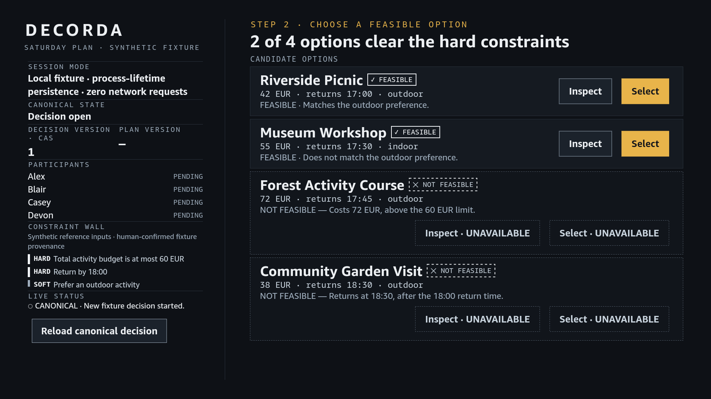
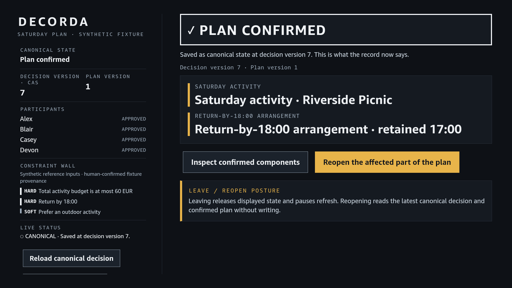
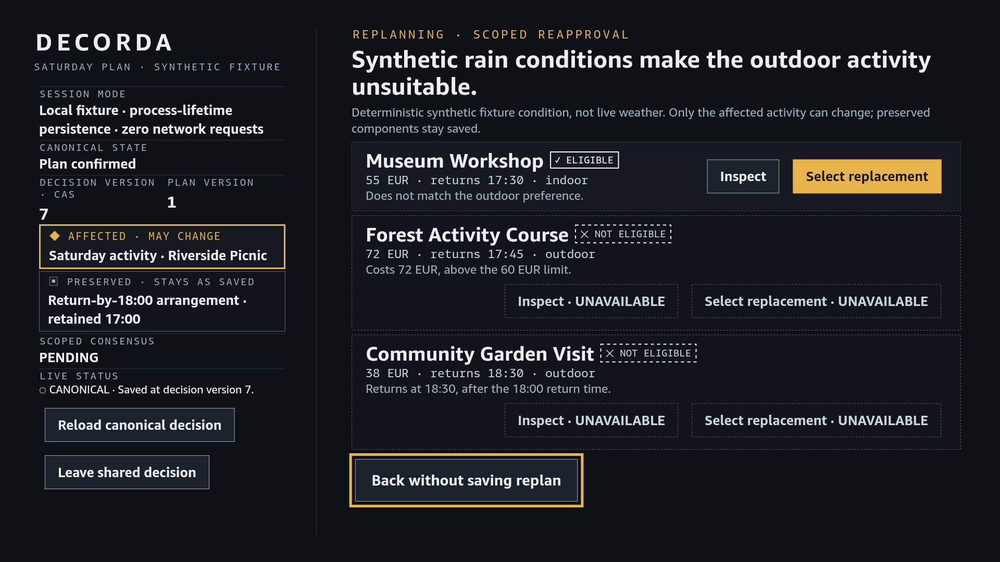
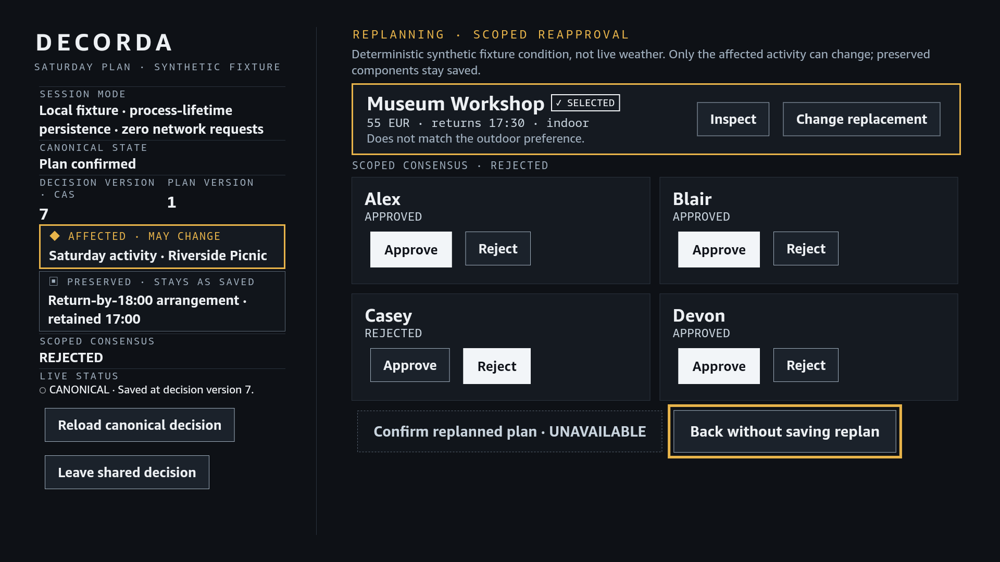
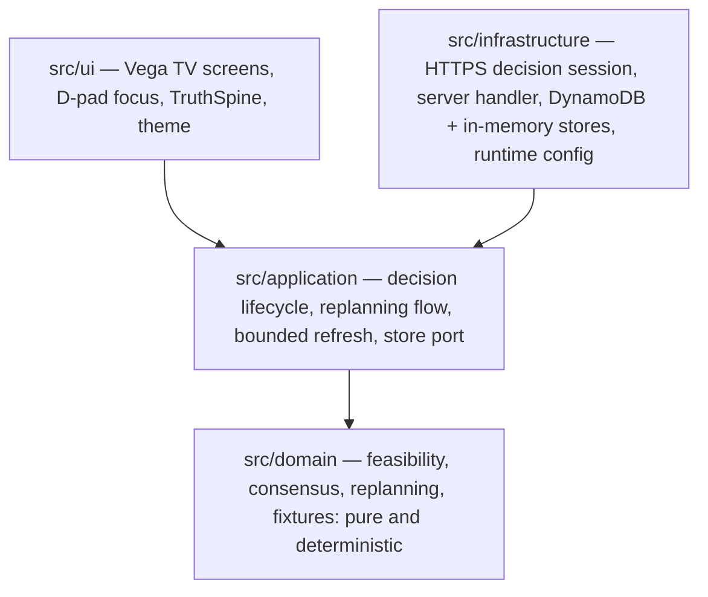

# DECORDA

**A TV-native shared decision room.** A household turns competing constraints
into one shared plan on a single screen — and when context changes, only the
affected part of the plan reopens. Everything else stays saved. Confirmation is
always an explicit act: approvals alone never commit a plan.

DECORDA is built with React Native for Vega (React 19.2 / React Native 0.83)
and targets Vega OS `1.2` at 1920x1080. Package identity:
`com.agentisstudio.decorda` (component `com.agentisstudio.decorda.main`).

```text
TECHNICAL_QUALIFICATION=PASS
TECHNICAL_BLOCKERS=NONE
```

Local regression, the Release build, the native Vega Virtual Device
qualification and a joined durable HTTPS/Lambda/DynamoDB qualification all
passed on 2026-09-17. What each of those means, and what it deliberately does
not mean, is in [docs/VERIFICATION.md](docs/VERIFICATION.md).

## Demo video

▶ [Watch DECORDA — A TV-Native Shared Decision Room](https://youtu.be/C4sDO5JaRjc)

The master is produced, QA-passed and frozen.

## Product screenshots

All four images below are unmodified native captures of the real DECORDA
Release package running on a Vega Virtual Device (`tv - aarch64`), captured
guest-side at the full 1920x1080 framebuffer during release qualification. They
are byte-identical copies of the approved release frames; their SHA-256 values
are recorded in [PROVENANCE.md](PROVENANCE.md).

### 1. Candidates — feasibility first



The opening stage after an explicit start. The truth spine on the left shows
the session mode, canonical state, both version axes, all four participants,
the constraint wall and live status in one always-visible column. The stage
shows all four candidate options with their feasibility verdicts: *Riverside
Picnic* and *Museum Workshop* clear the hard constraints and are selectable;
*Forest Activity Course* (72 EUR, over the 60 EUR budget) and *Community Garden
Visit* (returns 18:30, after the 18:00 return) are shown with explicit
`NOT FEASIBLE` reasons and `UNAVAILABLE` controls. **Infeasible options are
never hidden.**

### 2. Canonical plan confirmed



After the explicit Confirm, the plan exists as canonical state: decision (CAS)
version 7, plan version 1, all four participants APPROVED, with the confirmed
components listed — *Saturday activity · Riverside Picnic* and *Return-by-18:00
arrangement · retained 17:00*. **This frame is captured at a scrolled
truth-spine position:** DECORDA deliberately does not reset unrelated scroll
state, which is exactly what the release qualification used this frame to
prove.

### 3. Replan Stage A — choose a replacement



A deterministic synthetic context change — rain, not live weather — makes the
outdoor activity unsuitable. The spine marks *Saturday activity · Riverside
Picnic* as `AFFECTED · MAY CHANGE` while *Return-by-18:00 arrangement* is
`PRESERVED · STAYS AS SAVED`. Stage A lists all three eligible and ineligible
replacements with explicit reasons; *Back without saving replan* abandons the
draft with zero durable writes.

### 4. Replan Stage B — scoped re-approval



After a real replacement selection (*Museum Workshop · SELECTED*), Stage B asks
only for the affected scope: four scoped response cards with Approve/Reject.
Here a real rejection sets `SCOPED CONSENSUS · REJECTED`, so *Confirm replanned
plan · UNAVAILABLE* is correctly inert. The selected summary offers *Inspect*
and *Change replacement* without losing the draft. Consensus is necessary but
never sufficient: only the explicit Confirm commit creates plan version 2.

## What DECORDA does

DECORDA is built around one idea: **a shared decision is not a form somebody
fills in — it is a lifecycle with an explicit commit point.**

- **Participant response, readiness, commitment and canonical state are four
  different things.** Four approvals make a decision *ready*; nothing is
  committed until one participant performs the explicit Confirm. The canonical
  state — what the record actually says, with its version numbers — is always
  visible on screen, separate from what the room is currently doing.
- **Context changes reopen only what they affect.** A deterministic fixture
  change (rain disrupting an outdoor plan) classifies plan components into
  *affected* (may change) and *preserved* (stays as saved). Replanning is
  scoped to the affected component; preserved components carry over untouched.
- **The truth stays on screen.** A persistent left-hand *TruthSpine* shows
  session mode, canonical state, both version axes, participants, constraints,
  affected/preserved scope and live status during every stage, so the
  difference between what is draft and what is saved is never ambiguous.

All participant names, options, constraints and the context change are
deterministic synthetic fixtures. **No real personal data, no live external
sources, no model calls.**

## Decision lifecycle

The qualified end-to-end lifecycle, each step driven through real on-screen
controls during native qualification:

```text
Open  →  Candidates  →  Responses  →  READY  →  explicit Confirm
      →  canonical plan (CAS 7 · plan 1)
      →  context change (synthetic rain)
      →  affected-only replan (Stage A: choose replacement)
      →  scoped re-approval (Stage B: four scoped responses)
      →  explicit replan Confirm  →  canonical plan v2 (CAS 8 · plan 2)
```

What the lifecycle guarantees:

- **Open is not create.** Opening a missing decision reports `NOT FOUND`; a new
  decision exists only after an explicit *Start new fixture decision* performs
  a conditional create (CAS version 1).
- **Back is safe.** Leaving a replan draft — via *Back without saving replan*,
  hardware Back, or abandonment — performs zero durable writes. This was proven
  against real DynamoDB: version, plan version, operation-id count and both
  components identical before and after an abandoned draft.
- **Leaving pauses, reopening recovers.** Leaving releases displayed state and
  pauses refresh; reopening reads the latest canonical decision without
  writing. A genuinely fresh client recovered the confirmed plan from DynamoDB
  at the latest version, including from a forced-cold execution environment.

## Hard constraints and soft preferences

The deterministic Saturday fixture exercises both kinds of guidance:

| Constraint | Kind | Candidate effects |
|---|---|---|
| Total activity budget at most 60 EUR | **hard** | Forest Activity Course (72 EUR) is `NOT FEASIBLE` |
| Return by 18:00 | **hard** | Community Garden Visit (returns 18:30) is `NOT FEASIBLE` |
| Prefer an outdoor activity | **soft** | Museum Workshop is feasible but noted: "Does not match the outdoor preference" |

Feasibility is computed by pure domain functions (`src/domain/feasibility.ts`)
from the constraint values — never by the UI, never by the persistence layer.
Infeasible candidates remain visible with their reasons and inert controls, so
the room can see *why* an option is excluded.

## Explicit confirmation semantics

This is the central product invariant, preserved everywhere — UI, application,
domain and persistence:

> **FOUR APPROVALS != PLAN COMMIT.**
> **READY != CONFIRMED.**
> **ONLY AN EXPLICIT CONFIRM COMMITS.**

Observed directly in the durable qualification: after all four participants
approved, DynamoDB held all four responses **and `confirmed_plan` was absent**
at CAS version 6. The screen agreed — `PLAN VERSION` still showed `—`. The plan
came into existence only when a participant activated *Confirm selected plan*,
producing CAS version 7 with durable plan version 1. The same semantics govern
replanning: a full set of scoped approvals only arms *Confirm replanned plan*;
the second plan version appears only after that explicit confirm (CAS 7→8,
plan 1→2).

The inverse also holds: after confirmation, ordinary selection attempts are
rejected by the application with `REJECTED / ALREADY_CONFIRMED` and zero state
change — a confirmed plan cannot be silently cleared or overwritten.

## Decision (CAS) version vs plan version

DECORDA displays two separate version axes side by side in the TruthSpine, and
they count different things:

- **Decision version · CAS** — the optimistic-concurrency version of the whole
  canonical record. Every committed mutation increments it exactly once, and
  every mutation must supply the base version it computed against.
- **Plan version** — how many times an **explicit Confirm** has created or
  replaced the canonical plan. Participant responses, selections and replan
  drafts never move it.

The qualified lifecycle shows the axes separating clearly: four approvals take
CAS 1→6 with plan version still absent; the initial Confirm takes CAS 6→7 and
plan —→1; the entire replan draft (selection plus four scoped responses) writes
nothing while CAS stays 7; the replan Confirm takes CAS 7→8 and plan 1→2.
A consumer who watched only the plan version would miss the whole draft
lifecycle; DECORDA never lets them.

## Scoped replanning

Context changes are classification events, not resets:

1. **Classification.** The context change names the affected component
   (`component-activity`) and the preserved component
   (`component-return-arrangement`). Classification is deterministic domain
   data.
2. **Stage A — choose a replacement.** Replan Stage A lists all replacement
   options with eligibility and reasons. Selection is write-free — it updates
   only the transient draft. *Back without saving replan* and hardware Back
   abandon the draft with zero durable mutation.
3. **Stage B — scoped re-approval.** Only the affected scope re-asks the room:
   four scoped responses. A real rejection sets `SCOPED CONSENSUS · REJECTED`
   and keeps *Confirm replanned plan · UNAVAILABLE* — consensus is necessary,
   never self-executing.
4. **Change replacement.** Stage B's *Change replacement* returns to Stage A
   with the draft retained; reselecting the same option preserves responses,
   switching resets only the renewed scoped responses.
5. **Explicit replan Confirm.** Only this creates the next canonical version:
   CAS 7→8, plan version 1→2, affected component now `option-museum-workshop`.
6. **Preserved means preserved.** The durable record kept
   `component-return-arrangement = option-riverside-picnic` across the whole
   replan.
7. **Invalidation is honest.** If a newer canonical version arrives while a
   draft is open, the draft is invalidated with an assertive announcement —
   nothing merges silently.

## Runtime modes

DECORDA has two session compositions with identical application semantics,
selected by launcher-injected configuration — never by silent fallback:

| | **Local fixture mode** (default) | **Durable HTTPS mode** |
|---|---|---|
| Store | Process-memory, deterministic fixtures | Server-owned DynamoDB adapter behind HTTPS |
| Network | **Zero requests** | Real HTTPS; the configured endpoint must use the HTTPS scheme |
| Persistence | Process lifetime; restart resets | Durable canonical record per decision |
| Session bound | 10 minutes; expiry refuses mutations with an explicit `EXPIRED` message | Bounded expiry from configuration |
| Qualification role | Local verification only — **not** durable qualification | The mode that underwent joined qualification |

Missing or invalid durable configuration renders as unavailable. **It never
falls back to memory.** TV-side configuration carries no cloud credentials,
table names or account identifiers — actual endpoint values stay outside
tracked files and logs.

## Consistency and concurrency

The persistence contract
([docs/PERSISTENCE_CONTRACT.md](docs/PERSISTENCE_CONTRACT.md)) is built on one
canonical DynamoDB item per decision with conditional writes:

- **Operation ids with bounded receipts.** Every successful mutation appends a
  fixed-size receipt (operation id, mutation fingerprint, committed version).
  Replay adjudication compares the stored fingerprint byte-for-byte.
- **CAS conditional writes.** A mutation commits only when the stored version
  equals the caller's base version and the operation id is absent. There is no
  merge, no partial write, no last-write-wins and no automatic retry (the
  server-side SDK client is constructed with `maxAttempts: 1`).
- **Classified outcomes, not exceptions.** `APPLIED`, `IDEMPOTENT_REPLAY`,
  `OPERATION_ID_CONFLICT`, `STALE_VERSION`, `ALREADY_EXISTS`, `LIMIT_EXCEEDED`
  — plus the application-level `REJECTED / ALREADY_CONFIRMED` short-circuit.
  Replay and conflict adjudication take precedence over stale adjudication.
- **Bounded by design.** One item at most 32 KiB, at most 40 logical mutations
  (mutation 41 fails closed), strongly consistent reads, no scans or queries.
- **Latest-version recovery.** A genuinely fresh client recovered the confirmed
  decision from DynamoDB — not memory — including against a forced-cold Lambda
  execution environment (`LOADED` at version 7 with the confirmed plan).
- **Bounded polling.** Canonical refresh runs on a fixed 2000 ms interval with
  at most one read in flight and a hard read ceiling below the contract's
  300-poll budget. Observed on the real path: exactly 4 reads then stop
  `READ_LIMIT`, intervals 2002–2005 ms against the frozen 2000 ms.

**CAS caveat, preserved from qualification.** `REPLAYED`, `STALE_VERSION` and
`OPERATION_ID_CONFLICT` were all genuinely observed against the real DynamoDB
path. A nuance is preserved deliberately: on an *already-confirmed* decision,
ordinary mutations are correctly short-circuited earlier by the application
with `REJECTED / ALREADY_CONFIRMED` before the CAS layer, so the genuine
`STALE_VERSION` and `OPERATION_ID_CONFLICT` observations were made in a
**labelled pre-confirmation test-control window** on the same real table and
endpoint (one direct test-control record deletion, disclosed) — not in the
ordinary post-confirm user lifecycle. Nothing here claims that normal user flow
naturally reaches those outcomes.

## Native Vega TV UX

- **Ten-foot layout, D-pad first.** Directional input, Select and Back are the
  controls. Focus is managed through spatial navigation with explicit
  registration, exact-origin restoration after detail views and a deterministic
  fallback when the origin is gone. Every focus treatment is visible without
  color alone (scaled control, full border frame).
- **TruthSpine scroll-origin restoration.** Entering Replan Stage A or B snaps
  the truth spine to its top (`y = 0`) via a derived `originKey`
  (`replan-stage-a` / `replan-stage-b` / `outside-replan`); unrelated
  transitions deliberately do not normalize. The release qualification proved
  this with a falsifying control frame: the spine was genuinely scrolled in the
  confirmed stage immediately before the transition, and at the origin one
  transition later.
- **Two-stage Replan.** The complete replan stage does not fit — and should not
  cram — into one screen; it is composed as Stage A (context and replacement
  choice) and Stage B (selected summary and scoped re-approval), each of which
  does. The reasoning and the arithmetic are in
  [docs/ARCHITECTURE.md](docs/ARCHITECTURE.md).
- **Full-fit qualification at 1920x1080.** Three surfaces were qualified as
  fitting their entire content — spine, stage, controls and focus frames — in a
  single native viewport at scroll origin: **Candidates**, **Replan Stage A**
  and **Replan Stage B**, each with its relevant TruthSpine state. Their
  deterministic layout budgets are enforced by tests (candidates spine 969,
  Stage A 963, Stage B 959, replan spine 970 — all ≤ 976 available logical
  pixels), with a task-critical font floor of 19 px. On those three surfaces
  there is no ellipsis, no clipping and no scrolling requirement. The claim is
  limited to them; other stages are not covered by it.
- **Qualified on real hardware paths.** The native session ran the Release
  package on a Vega Virtual Device (`tv - aarch64`), driven through real
  guest-side input injection, with full 1920x1080 guest-framebuffer captures —
  no stitched images, no HTML substitutes, no state injection.

## Accessibility

DECORDA's accessibility posture, as implemented and locally measured:

- Every control is an accessible button with a spoken label (and optional
  hint), `accessibilityRole="button"` and an explicit `accessibilityState`
  (`disabled`, `selected`).
- Status changes announce through a polite live region (`LIVE STATUS`); draft
  invalidation announces assertively.
- State never relies on color alone: text marks (`UNAVAILABLE`,
  `NOT FEASIBLE`, `AFFECTED · MAY CHANGE`, `PRESERVED · STAYS AS SAVED`),
  border weight and style differences, and status glyphs carry the same
  information.
- Disabled controls keep full text contrast and gain an explicit textual cue
  instead of a whole-control opacity fade.
- Measured WCAG relative-luminance contrast of the shipped palette:
  white/card 15.68:1, secondary text/screen 13.47:1, blue heading/screen
  12.25:1, warning/card 10.88:1, confirmed green/confirmed card 7.17:1,
  card boundary/card 4.16:1, focus border/focused control 4.84:1,
  white/enabled control 10.23:1.

**No accessibility certification is claimed.** Platform assistive-technology
announcement behavior and human ten-foot legibility at 1920x1080 are not
independently certified.

## Architecture

Four layers with one-directional imports (`domain ← application ← ui`;
infrastructure implements application and domain contracts and is never
imported by them):



- `src/domain` — pure types, fixtures, feasibility, consensus and replanning
  rules. No UI, network, storage or platform dependencies.
- `src/application` — use-case orchestration: canonical lifecycle transitions,
  the replanning flow and the bounded refresh controller. Composes domain
  behavior; owns the persistence port.
- `src/ui` — React Native for Vega presentation: screens, focusable controls,
  the TruthSpine and the compact-fit theme. Consumes application results only.
- `src/infrastructure` — external adapters: the TV-side HTTPS decision session,
  the server-side decision handler, the DynamoDB adapter (with an in-memory
  contract twin) and runtime configuration. The server composition derives all
  mutations through the same application and domain transitions — it never
  accepts arbitrary snapshots.

Full detail, including the two runtime modes and the two-stage Replan design:
[docs/ARCHITECTURE.md](docs/ARCHITECTURE.md).

## Durable qualification

DECORDA's durable mode was qualified end-to-end against real cloud
infrastructure on 2026-09-17, in `us-east-1`, under a hackathon
promotional-credit envelope:

```text
real product client adapter (src/infrastructure/network/httpDecisionSession.ts)
  → real HTTPS request over TLS
  → real AWS Lambda (the repository's own compiled backend)
  → real decision handler → application lifecycle → replanning flow
  → real DynamoDB adapter → real DynamoDB table
  → fresh-client read / poll / reopen path
```

- **28 effective qualification rows, 28 PASS, 0 FAIL**, spanning the explicit
  initial confirmation invariant, fresh-client recovery, replay and CAS safety,
  scoped replan with a preserved component, unfinished-Back zero-write and
  bounded polling.
- **Durable state was observed independently of the product path** — direct,
  strongly consistent `GetItem` calls before and after every sensitive step.
  No row infers a durable write from an HTTP status.
- **The qualification stack was ephemeral and is gone.** One DynamoDB table,
  one least-privilege IAM role, one Lambda function, one Function URL and one
  log group existed for under 25 minutes and were deleted; absence was verified
  by querying afterwards. `RESIDUAL_RESOURCE_COUNT=0`. No hosted judging or
  demo backend exists; promotional-credit consumption was conservatively under
  $0.01 and personal spend was $0.00.
- **Disclosed deviation:** the qualification endpoint used `AuthType AWS_IAM`
  (SigV4) rather than a public unauthenticated URL — a strictly stronger
  transport posture. The joined server path (HTTPS → Lambda → handler →
  application → DynamoDB adapter → DynamoDB) is the product path either way.

This qualification is recorded evidence of a bounded session. **It is not an
offering of a hosted service, and no persistent infrastructure remains.**

## Verification

Evidence layers are kept distinct. Local test pass is not native runtime pass;
build pass is not release pass; HTTP success is not a durable write.

| Layer | Result |
|---|---|
| Full local regression | **PASS — 424 tests / 25 suites** (`npm test -- --runInBand`) |
| Lint | **PASS** — 0 errors (11 pre-existing style warnings) |
| Typecheck | **PASS** — `tsc --noEmit`, no output |
| Whitespace/conflict check | **PASS** — `git diff --check` |
| Release build | **PASS** — `vega vtbuild` exit 0, manifest validation 0 errors, three architectures |
| Native Vega Virtual Device (Release package) | **PASS** — scroll-origin contract with falsifying control, full-spine and full-stage fit, complete two-stage Replan through real controls, 1920x1080 guest-framebuffer captures |
| Joined durable HTTPS/Lambda/DynamoDB | **PASS** — 28/28 effective rows against real cloud infrastructure, independently observed durable state |

Every public claim, the evidence class behind it, what you can reproduce
yourself and the caveats that must not be dropped:
**[docs/VERIFICATION.md](docs/VERIFICATION.md)**.

## Build and local native run

Prerequisites: Node ≥ 20, npm 10.x, the Vega CLI with an active Vega SDK
(release evidence used Vega CLI 1.3.4, SDK 0.24.9914), and an eligible Vega
device or Virtual Device for launch.

```sh
npm ci

# local verification
npm test -- --runInBand     # 424 tests / 25 suites
npm run lint
npx tsc --noEmit

# packages (output under gitignored build/)
npm run build:release
npm run build:debug
```

The full proven procedure — starting the local Vega Virtual Device at
1920x1080, installing and launching the Release package, driving the product
with real guest-side input and capturing native framebuffer evidence — is
written up step by step in [docs/NATIVE_RUN.md](docs/NATIVE_RUN.md), including
the known-ineffective input and capture routes and the 10-minute fixture
window. Local fixture sessions expire after 10 minutes by design and refuse
further mutations with an explicit message.

## Repository structure

```text
manifest.toml            Vega package manifest (identity, OS target, build number)
package.json             scripts and pinned toolchain
index.js                 app registration entrypoint
src/
  domain/                pure decision domain: types, fixtures, feasibility,
                         consensus, replanning
  application/           lifecycle, session, bounded refresh, replanning flow,
                         store port
  ui/                    Vega TV screens, focusable control, TruthSpine, theme
  infrastructure/        HTTPS session, server handler, DynamoDB + in-memory
                         stores, runtime config
test/                    Jest suites mirroring the source layers (424 tests)
scripts/                 package-decision-backend.mjs — offline backend packaging
docs/
  ARCHITECTURE.md        layers, import direction, runtime modes, replan design
  VERIFICATION.md        every public claim and the evidence class behind it
  DECISION_RUNTIME.md    runtime modes and bounded session behavior
  PERSISTENCE_CONTRACT.md the frozen CAS/idempotency persistence contract
  NATIVE_RUN.md          local Vega Virtual Device run and capture procedure
  design/                the frozen TV UI design package
  assets/readme/         the four native screenshots on this page
PROVENANCE.md            authorship, dependencies, licensing, evidence provenance
LICENSE                  MIT
```

## Privacy, security and cost truth

Evidence-backed statements only. **No security, certification or
production-readiness claim is made anywhere.**

- **Synthetic data only.** All participants, options, constraints and context
  changes are deterministic fixtures. The "rain" that triggers replanning is a
  deterministic synthetic condition — DECORDA does not call a weather service.
  The persistence contract forbids storing real household personal data,
  credentials, tokens, cloud identifiers or payment data; only bounded
  synthetic decision state is ever persisted.
- **No model calls.** The product performs no inference of any kind.
- **No telemetry, no analytics, and no network in the default mode.** Local
  fixture mode performs zero network requests — an observed property of the
  qualified runtime, not an aspiration.
- **Zero standing infrastructure.** `RESIDUAL_RESOURCE_COUNT=0` — the
  qualification stack was deleted and its absence observed by querying. Nothing
  is hosted; no endpoint, table, function or log group remains. This is a
  historical observation from the qualification session and does not establish
  the state of any cloud account today.
- **Minimal consumption.** The joined qualification consumed a conservatively
  estimated < $0.01 of promotional credit in under 25 minutes of stack
  lifetime; personal spend was $0.00. Local development and the native virtual
  device path use zero cloud resources.

Deliberately omitted because they are volatile or non-public: account
identifiers, resource names, endpoint identifiers, credit identifiers,
remaining balances and price quotes.

## Status and limitations

```text
TECHNICAL_QUALIFICATION=PASS
TECHNICAL_BLOCKERS=NONE
```

Honest limitations of the current artifact:

- **One deterministic synthetic fixture scenario** (the Saturday plan). There
  is no general-purpose decision configuration.
- **Local fixture mode is process-lifetime only.** Durable mode requires an
  authorized launcher-injected HTTPS configuration and **has no public hosted
  deployment**.
- **Production identity, app-store publication and certification are out of
  scope.**
- **Layer boundaries are enforced by convention and review**, not by a
  build-time checker.

## License

DECORDA was authored as a concept submission for the Amazon App Dev 2026
hackathon.

- DECORDA's original project-owned source and documentation are released under
  the MIT License — Copyright (c) 2026 Elói Ramos ([LICENSE](LICENSE)).
- The required Vega toolchain and runtime packages (`@amazon-devices/*`) remain
  under their own terms (Amazon Program Materials License) and are **not
  relicensed by this project**. Other third-party dependencies remain under
  their respective licenses: React (MIT), React Native (MIT) and
  `@aws-sdk/client-dynamodb` (Apache-2.0). The MIT grant covers project-owned
  DECORDA material only; the full dependency and license inventory is recorded
  in [PROVENANCE.md](PROVENANCE.md).
- The npm package name `@amazon-devices/decorda` is the Vega generator default.
  The package is `private: true` and is never published to npm. It implies no
  affiliation with or endorsement by Amazon.
