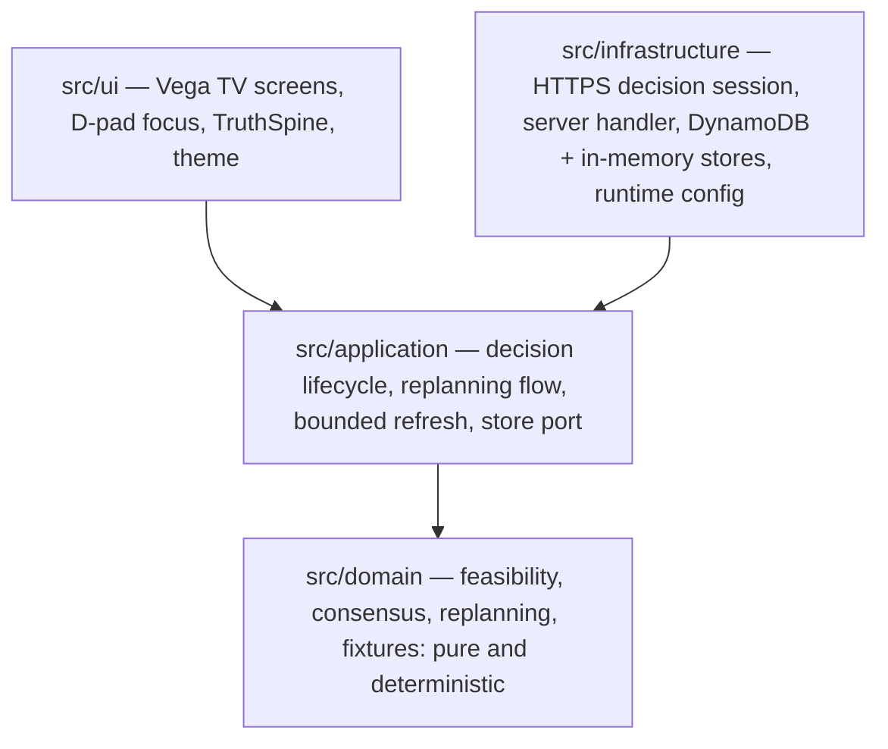

# Architecture

This document should let you answer four questions about DECORDA without
reading the source: what the layers are and which way imports go, how the two
runtime modes differ, what the confirmation and version semantics actually
mean, and why Replan is composed as two stages.

## 1. Layers and import direction

DECORDA is layered, and the dependency direction is one-way:

```text
domain  <-  application  <-  ui
domain  <-  application  <-  infrastructure
```



- **`src/domain/`** — pure product rules: decision types, deterministic
  fixtures, feasibility evaluation, consensus, replanning transitions. Depends
  on nothing above it: no UI, no network, no cloud adapter, no platform module.
- **`src/application/`** — orchestration: the canonical decision lifecycle,
  session handling, bounded refresh, the replanning flow, and the store *port*
  (an interface, not an implementation). Composes domain behavior; contains no
  UI and no transport.
- **`src/ui/`** — the React Native for Vega TV surface: screens, the persistent
  TruthSpine status column, the focusable control primitive, theme tokens. May
  depend on application and domain; domain never depends on UI.
- **`src/infrastructure/`** — external adapters behind the application's ports:
  an in-memory store, a DynamoDB store, an HTTPS session client, the
  server-side decision handler, and runtime configuration. Implements
  contracts; owns no product rules.

There are no circular layer dependencies. Tests mirror the source layers under
`test/`.

**Stated honestly: this is enforced by convention and review, not by a
build-time checker.** No lint rule or bundler constraint in this repository
fails a build for an upward import. The claim is a description of how the code
is organized and maintained, not a mechanically guaranteed invariant.

The adapter boundary is the load-bearing part. The lifecycle does not know
whether it is talking to memory or to a database. That is what makes the two
runtime modes possible without branching product logic — and it is why the
server composition derives every mutation through the same application and
domain transitions rather than accepting arbitrary snapshots.

## 2. Two runtime modes

Both compositions have identical application semantics. The mode is selected by
launcher-injected configuration — never by silent fallback.

| | **Local fixture mode** (default) | **Durable HTTPS mode** |
|---|---|---|
| Store | in-memory, deterministic fixtures, process lifetime | server-owned DynamoDB adapter behind HTTPS |
| Network | **zero requests** | real HTTPS over TLS to the project's own endpoint |
| Persistence | restart resets | durable canonical record per decision |
| Session bound | 10 minutes; expiry refuses mutations with an explicit `EXPIRED` message | bounded expiry from configuration |
| Availability | always | requires an authorized launcher-injected configuration |
| Deployment observation | n/a | qualification stack removed at teardown; current state requires fresh observation |

Two properties matter more than the table:

- **Missing or invalid durable configuration renders as unavailable. It never
  falls back to memory.** A silent downgrade from durable to in-memory would
  make the record lie about what is saved, so it is not implemented.
- **Local fixture mode performs zero network requests.** This is an observed
  property of the qualified runtime, not an aspiration.

TV-side configuration carries no cloud credentials, table names or account
identifiers. See [DECISION_RUNTIME.md](DECISION_RUNTIME.md) for the
configuration shape and the bounded session behavior.

## 3. Confirmation and version semantics

### Explicit confirmation

Participant response, readiness, commitment and canonical state are four
different things:

> **FOUR APPROVALS != PLAN COMMIT.**
> **READY != CONFIRMED.**
> **ONLY AN EXPLICIT CONFIRM COMMITS.**

Agreement arms the Confirm control. It never executes it. The same semantics
govern replanning: a full set of scoped approvals only arms *Confirm replanned
plan*.

### Two version axes

- **Decision version (CAS)** — the optimistic-concurrency version of the whole
  canonical record. Every committed mutation increments it exactly once, and
  every mutation must supply the base version it computed against.
- **Plan version** — how many times an explicit Confirm has created or replaced
  the canonical plan. Participant responses, selections and replan drafts never
  move it.

They are surfaced separately, side by side in the TruthSpine, so a viewer can
tell a draft from a saved record. A consumer watching only the plan version
would miss the entire draft lifecycle.

### Compare-and-set writes

Durable mutations are conditional on the version the client last read:

- A mutation commits only when the stored version equals the caller's base
  version **and** the operation id is absent.
- There is **no merge, no partial write, no last-write-wins, and no automatic
  retry** — the server-side SDK client is constructed with `maxAttempts: 1`.
- Every successful mutation appends a fixed-size receipt (operation id,
  mutation fingerprint, committed version). Replay adjudication compares the
  stored fingerprint byte-for-byte.
- Outcomes are **classified, not thrown**: `APPLIED`, `IDEMPOTENT_REPLAY`,
  `OPERATION_ID_CONFLICT`, `STALE_VERSION`, `ALREADY_EXISTS`, `LIMIT_EXCEEDED`,
  plus the application-level `REJECTED / ALREADY_CONFIRMED` short-circuit.
  Replay and conflict adjudication take precedence over stale adjudication.
- Bounded by design: one item at most 32 KiB, at most 40 logical mutations
  (mutation 41 fails closed), strongly consistent reads, no scans or queries.
- Canonical refresh runs on a fixed 2000 ms interval with at most one read in
  flight and a hard read ceiling below the contract's 300-poll budget.

The frozen detail — item and key model, exact CAS behavior, idempotency design,
bounds and non-goals — is in
[PERSISTENCE_CONTRACT.md](PERSISTENCE_CONTRACT.md).

## 4. Why Replan is two-stage

This is a layout finding that became an architecture decision, and it is worth
stating plainly because the alternative was to quietly cram or clip the screen.

At 1920x1080 with the shell's 52 px vertical padding, the safe vertical
interval is **976 logical pixels**. The complete Replan stage — context
heading, all three replacement rows, the scoped-consensus label, all four
participant cards with all eight response controls, and the final Confirm/Back
row — measured approximately **1581 px**, roughly **605 px over budget**.

That gap could not be closed safely. A deliberately over-aggressive comparison
— removing every stage gap, every participant vertical padding, the grid gap
and the card gaps, and dropping the heading group to an optimistic 96 px —
still landed near 1263 px, about 287 px too tall. The reason is structural: at
the unchanged 1170 px content width each response card is 573 px wide, and its
two action frames cannot share one row in the disabled state, so the grid needs
two action rows per card. Shrinking text below the 19 px task-critical floor,
clipping with `numberOfLines`, or hiding a control were all rejected — an
option you cannot read is not a fitted option.

So Replan is **composed** as two stages on an unchanged application state
machine:

- **Stage A** — context and replacement choice: the Replanning eyebrow, the
  full context-reason headline, the explanatory note, all three replacement
  rows with their eligibility states, and *Back without saving replan*.
- **Stage B** — selected summary and scoped re-approval: the eyebrow, the
  explanatory note, the selected replacement summary with *Inspect* and
  *Change replacement*, the scoped-consensus status, the 2x2 participant grid
  with all eight real controls, and the Confirm/Back row.

**This is presentation composition, not a state change.** Stage A and Stage B
are derived from existing selection and choice state. Polling, canonical
adoption, invalidation, stale/conflict/replay handling, affected/preserved
scope, CAS and plan version are untouched. Selection and participant responses
remain write-free in both stages; only an explicit Confirm invokes persistence.
*Change replacement* returns to Stage A with the draft retained — reselecting
the same option preserves responses, switching resets only the renewed scoped
responses.

### Layout budgets

The resulting budgets are deterministic acceptance ceilings, enforced by
`test/ui/theme/conceptA.spec.ts`, which ships:

```text
Available safe height at 1920x1080      976 logical px
Candidates spine                        969
Replan spine                            970
Replan Stage A                          963
Replan Stage B                          959
Task-critical font floor                 19 px
```

The spine figures come from a presentation-only compact-fit TruthSpine variant
(reduced block padding and gaps, a tightened live-status line height) applied
to Candidates and both Replan stages. Content, session copy, participant and
constraint inventory, version wrapping, footer controls and focus treatment are
all unchanged; no font size was reduced.

A React test renderer does not measure native text, so this arithmetic is a
deterministic structural contract rather than a native measurement. Native
captures check its font and wrap assumptions. Exceeding an allocation is a
failure — not permission to truncate text or shrink type.

### Scroll-origin restoration

Entering Replan Stage A or B snaps the truth spine to its top (`y = 0`) via a
derived `originKey` (`replan-stage-a` / `replan-stage-b` / `outside-replan`).
Unrelated transitions share one key, so the effect deliberately does **not**
fire between them — the spine keeps whatever scroll position the viewer left it
at.

That negative requirement is the interesting half, and it was proved rather
than asserted: the release qualification captured a falsifying control frame in
which the spine was genuinely scrolled at the confirmed stage immediately
before the transition, and at the origin one transition later. The same frame
simultaneously shows the spine staying scrolled across an unrelated transition.
It is screenshot #2 in the project README.

## 5. Scoped replanning

Context changes are classification events, not resets:

1. **Classification.** The context change names the affected component
   (`component-activity`) and the preserved components
   (`component-return-arrangement`). Classification is deterministic domain
   data.
2. **Stage A.** Replacement options are listed with eligibility and reasons.
   Selection is write-free — it updates only the transient draft.
3. **Stage B.** Only the affected scope re-asks the room. A single rejection
   sets `SCOPED CONSENSUS · REJECTED` and keeps *Confirm replanned plan ·
   UNAVAILABLE*.
4. **Explicit replan Confirm.** Only this creates the next canonical version.
5. **Preserved means preserved.** The preserved component carries through the
   whole replan untouched, in the durable record as well as on screen.
6. **Invalidation is announced.** If a newer canonical version arrives while a
   draft is open, the draft is invalidated with an assertive announcement.
   Nothing merges silently.

Leaving an unfinished replan — via *Back without saving replan*, hardware Back,
or abandonment — performs zero durable writes.

## 6. Feasibility

Feasibility is computed by pure domain functions
(`src/domain/feasibility.ts`) from the constraint values — never by the UI,
never by the persistence layer. Infeasible candidates stay visible with their
reasons and inert controls. A disabled option is never shown without saying
which hard constraint it violates.

Soft preferences are trade-offs, not gates: an option can be feasible and still
be marked as missing a stated preference.
